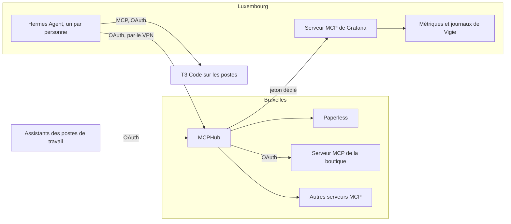

# 🤖 Assistants IA

Les assistants IA (Claude Code, Codex, OpenCode, Antigravity…) accèdent aux outils de l’infrastructure par le protocole [MCP](https://modelcontextprotocol.io/), tous par le même point d’entrée : [MCPHub](https://github.com/samanhappy/mcphub). Quel que soit le fournisseur du modèle, il atteint les mêmes serveurs MCP, avec les mêmes droits.



## 🧭 MCPHub {#mcphub}

MCPHub (<RepositoryReference path="services/mcphub" />) tourne sur Bruxelles, à l’adresse `mcphub.anneraud.fr`, accessible uniquement depuis le réseau local ou le VPN. Il conserve ses serveurs et ses utilisateurs dans sa propre base PostgreSQL, sauvegardée par l’outil de sauvegarde des bases.

- **Connexion :** par [Zitadel](authentification.md) ; le compte `admin` local reste en secours. Une première connexion Zitadel crée un utilisateur ordinaire, nommé d’après son adresse, à promouvoir une fois depuis le compte `admin` (**Users**).
- **Comptes externes :** chaque utilisateur relie lui-même ses comptes aux serveurs qui utilisent OAuth (**Connect** sur le serveur).
- **Partage :** un serveur est privé, partagé avec un groupe ou public.
- **Outils :** chaque outil activé entre dans le contexte du modèle. Seuls les outils utiles restent activés, par exemple uniquement les outils de lecture du serveur de Paperless.

Le coffre `vault/mcphub/vault.yml` (créé avec `mise vault:create`) contient `mcphub_database_password`, `mcphub_jwt_secret`, `mcphub_better_auth_secret` (`openssl rand -hex 32` chacun) et `mcphub_admin_password`, utilisé seulement à la création du premier utilisateur. Le déploiement (`mise deploy services/mcphub/deploy.yml`) provisionne aussi l’application Zitadel, d’où le besoin d’OpenTofu.

## ⚕️ Assistants personnels {#hermes}

[Hermes Agent](https://hermes-agent.nousresearch.com/) (<RepositoryReference path="services/assistant" />) tourne sur Luxembourg, une instance par personne. Le tableau de bord de chacune a sa propre adresse (`assistant.anneraud.fr` pour l’administrateur), accessible uniquement depuis le réseau local ou le VPN. Contrairement aux assistants des postes de travail, Hermes agit seul : il exécute des commandes, lit le web, répond sur Matrix, délègue du code aux machines T3 Code et écrit ses propres compétences à partir de ce qu’il a fait. Une page ou un message peut donc tenter de le détourner (injection de prompt), d’où son isolement :

- **Une pile par personne :** chacune a son conteneur, son dossier (`/opt/<nom>/data` : configuration, identifiants, mémoire, compétences, sessions), son utilisateur Linux sans compte sur l’hôte et son bot Matrix. Un assistant ne lit pas les fichiers d’un autre.
- **Conteneur :** l’image démarre en root pour confier le dossier à cet utilisateur, puis fait tourner la passerelle et le tableau de bord sous son identité. Elle ne garde que les capacités Linux nécessaires à ce passage, avec 2 Go de mémoire et 512 processus au plus, et n’a pas accès au socket Docker.
- **Réseau :** chaque instance n’est jointe que par Traefik, et ne sort que vers les fournisseurs de modèles, Matrix, MCPHub et T3 Code.
- **Tableau de bord :** il exige un identifiant et un mot de passe, et ne fait confiance aux en-têtes transmis (adresse et protocole du client) que depuis le réseau de Traefik.

Les personnes sont listées dans le coffre `vault/assistant/vault.yml` (créé avec `mise vault:create`), pas dans le dépôt, qui est public :

```yaml
assistant_instances:
  - name: assistant # conteneur et dossier : assistant ou assistant-<mot>
    host: assistant.anneraud.fr # adresse du tableau de bord
    user: 2000 # utilisateur Linux, différent pour chaque personne
    dashboard_username: alix
    dashboard_password: "…" # au moins 20 caractères
    dashboard_secret: "…" # openssl rand -hex 32 : signe les sessions
    environment: # facultatif : clés de fournisseurs, connexion à Matrix
      MATRIX_HOMESERVER: "https://…"
      MATRIX_USER_ID: "@assistant:…"
      MATRIX_ACCESS_TOKEN: "…"
      MATRIX_ALLOWED_USERS: "@alix:…"
```

Les valeurs se limitent aux lettres, aux chiffres et à `._~:/+=@!,-`, car Compose interpréterait `$` et les guillemets. Après le déploiement (`mise deploy services/assistant/deploy.yml`), le modèle et les serveurs MCP se règlent dans chaque conteneur :

```bash
docker exec -it assistant hermes auth add openai-codex   # abonnement ChatGPT, par un code à saisir
docker exec -it assistant hermes config edit             # mcp_servers, voir ci-dessous
docker exec -it assistant hermes mcp login mcphub
```

```yaml
mcp_servers:
  mcphub:
    url: https://mcphub.anneraud.fr/mcp
    auth: oauth
```

MCPHub lui donne les outils de l’infrastructure (GitHub, Paperless…) ; Luxembourg l’atteint par le VPN, comme Vigie atteint Bruxelles. Chaque machine T3 Code expose aussi un serveur MCP (`https://<adresse>/mcp`, connexion OAuth en mode **Supervised**) : Hermes y lance et suit des threads (`t3_thread_launch`, `t3_thread_wait`), qui travaillent sur les dépôts de la machine. Ces adresses doivent être en `https` ; leur publication sur le VPN reste à faire.

Luxembourg n’est pas encore sauvegardé : les dossiers `data` non plus.

La CI (`.github/scripts/check-assistant.sh`) démarre Hermes avec ces réglages et vérifie qu’il tourne avec ses seules capacités, que la passerelle et le tableau de bord ne tournent pas en root, que le réseau de Traefik est approuvé une seule fois, et que le tableau de bord refuse un mauvais mot de passe.

## 💻 Postes de travail {#postes}

`mise deploy hosts/workstations/mcp.yml` branche les assistants du poste sur MCPHub, à l’adresse `https://mcphub.anneraud.fr/mcp` : Claude Code (par sa ligne de commande, pour l’utilisateur), Codex (`~/.codex/config.toml`), OpenCode (`~/.config/opencode/opencode.json`) et Antigravity (`~/.gemini/config/mcp_config.json`).

- Les autres réglages de ces fichiers sont conservés ; un fichier OpenCode commenté doit d’abord perdre ses commentaires.
- Aucune clé n’est écrite : les assistants se connectent par l’OAuth de MCPHub, qui doit être activé dans ses réglages.
- L’adresse `/mcp/$smart`, dont la recherche d’outils a besoin de pgvector et d’un service d’embeddings, n’est pas utilisée.
- Le poste doit être sur le réseau local ou le VPN. Les assistants se redémarrent ensuite.

## 📈 Supervision {#grafana}

Vigie fait tourner le serveur MCP officiel de Grafana (`grafana/mcp-grafana`) à l’adresse `https://vigie.anneraud.fr/mcp`, derrière la liste d’accès interne. Depuis MCPHub, un assistant interroge les métriques (PromQL) et les journaux d’accès de Traefik (LogsQL, avec la source `victorialogs`), lit les tableaux de bord et les règles d’alerte avec leur état. Voir [Supervision](supervision.md#assistant).

- Le serveur n’a aucun outil d’écriture, lit Grafana avec un compte de service en lecture seule et refuse toute requête sans son propre jeton.
- Il ne démarre qu’une fois ses deux jetons dans `vault/vigie/vault.yml`.

Mise en place, une fois :

1. Dans Grafana, en administrateur : **Administration → Users and access → Service accounts → Add service account** `mcp`, rôle **Viewer**, puis **Add service account token** (sans expiration, ou en notant la date).
2. `mise vault vault/vigie/vault.yml` : `vigie_mcp_grafana_token` (ce jeton) et `vigie_mcp_server_token` (`openssl rand -hex 32`), puis valider le coffre et son sous-module.
3. `mise deploy services/vigie/deploy.yml` : le conteneur `mcp` démarre.
4. Dans MCPHub (**Servers → Add**) : type Streamable HTTP, adresse `https://vigie.anneraud.fr/mcp`, en-tête `Authorization` = `Bearer <vigie_mcp_server_token>`. Tout utilisateur de MCPHub qui reçoit ce serveur voit toutes les métriques de Vigie : il reste dans le groupe du propriétaire.

## 🚂 Boutique Mini Train Store {#boutique}

La boutique Mini Train Store (<RepositoryReference path="services/boutique" />, [Vendure](https://vendure.io/)) tourne sur Bruxelles, pour l’instant sur un site de test privé, `test.minitrainstore.fr`. Son serveur Vendure contient un serveur MCP (`/mcp/admin`) : il donne à l’agent les outils de gestion de la boutique (annonces, commandes à expédier, clients en lecture), sans conteneur de plus. Les outils et leurs garde-fous sont décrits dans le dépôt de la boutique (`docs/conception/12-mcp.md`).

- **Adresse à part :** le serveur MCP et son OAuth ne sont servis qu’à l’adresse `mcp.test.minitrainstore.fr`, accessible uniquement depuis le réseau local ou le VPN. Elle mène au serveur Vendure entier : c’est l’émetteur OAuth (ses `/.well-known/…` y sont), et la page de consentement du Dashboard s’y ouvre. Sur `test.minitrainstore.fr`, `/mcp` et `/.well-known/oauth-*` ne mènent jamais au serveur ; la CI le vérifie.
- **MCPHub :** il tourne sur le même hôte et rejoint cette adresse en repassant par Traefik, qui le voit alors arriver d’une adresse Docker (`172.16.0.0/12`), refusée par la liste d’accès interne. Une seconde route, réservée à ces adresses, le laisse passer ; l’OAuth protège toujours le serveur MCP. L’optimiseur d’images du site (`/_next/image`) va chercher les photos de la même façon, à l’adresse du site : une route `/assets` réservée aux conteneurs de l’hôte le laisse passer, et le reste du site garde la liste d’accès.
- **Droits :** l’agent agit avec les droits du compte qui approuve la connexion. On approuve donc avec le compte dédié à l’agent (rôle « Agent LLM » : pas de suppression, pas de paramètres, pas d’étiquette Mondial Relay), jamais avec le compte SuperAdmin.
- **Jetons :** MCPHub reçoit un jeton d’accès de 15 minutes, qu’il renouvelle seul. Les connexions se consultent et se révoquent dans le Dashboard (**Paramètres > MCP**). `MCP_OAUTH_TOKEN_SECRET` sert à hacher les jetons enregistrés : le changer déconnecte tous les agents.

Le coffre `vault/boutique/vault.yml` (créé avec `mise vault:create`) contient :

- `boutique_registry_username` et `boutique_registry_token` : un compte GitHub et un jeton classique avec le droit `read:packages`, car les images sont privées ;
- `boutique_database_password` et `boutique_superadmin_password`, d’au moins 20 caractères ;
- `boutique_cookie_secret`, `boutique_revalidation_secret` et `boutique_mcp_oauth_token_secret` (`openssl rand -base64 32` chacun) ;
- `boutique_integrations`, facultatif : les réglages SMTP, Stripe, Turnstile, Mondial Relay et le compte « Vendeur », sous les noms des variables du serveur (`SMTP_HOST`, `STRIPE_SECRET_KEY`…).

Les valeurs se limitent aux lettres, aux chiffres et à `._~:/+=@!,-`, car Compose interpréterait `$` et les guillemets.

Mise en place, une fois :

1. Remplir le coffre, puis `mise deploy services/boutique/deploy.yml`.
2. Sur Bruxelles, dans le dossier de la boutique, créer la configuration initiale (pays, taxes, livraison, rôle « Agent LLM ») : `sudo docker compose -f /mnt/Donnees/Applications_chiffrees/Boutique/compose.yml --profile seed run --rm -T seed` (le dossier n’est lisible que par root, d’où `-f` plutôt qu’un `cd`). Ajouter aussi la base `boutique` à l’outil de sauvegarde des bases.
3. Dans le Dashboard (`https://test.minitrainstore.fr/dashboard`, compte SuperAdmin) : **Administrateurs > Nouveau**, un compte pour l’agent, avec son adresse et son mot de passe, et le rôle « Agent LLM ».

Le serveur se branche ensuite dans l’interface de MCPHub, pas dans le dépôt :

1. Se connecter à MCPHub avec un compte administrateur : MCPHub ne laisse joindre une adresse du réseau local qu’aux serveurs d’un administrateur. Vérifier que **Settings > Installation > Base URL** vaut `https://mcphub.anneraud.fr` : c’est l’adresse de retour de l’OAuth.
2. **Servers > Add** : type Streamable HTTP, adresse `https://mcp.test.minitrainstore.fr/mcp/admin`, sans en-tête. MCPHub découvre l’OAuth, s’enregistre seul (enregistrement dynamique) et utilise PKCE : rien d’autre à remplir. Garder le serveur privé.
3. **Connect** : le navigateur s’ouvre sur la page de consentement, `https://mcp.test.minitrainstore.fr/dashboard/mcp/authorize`. S’y connecter avec le compte de l’agent (dans une fenêtre privée si une autre session du Dashboard est ouverte), puis approuver la demande.
4. N’activer que les outils utiles.

### 📦 Importer les données de test {#boutique-import}

Pour essayer le site de test avec le catalogue du poste de développement (annonces, photos, commandes et factures de test), on remplace sa base et ses fichiers par ceux du poste. Ce qui était sur le site de test est perdu, y compris le compte de l’agent et sa connexion à MCPHub : ils se recréent ensuite. L’image déployée doit avoir les mêmes migrations que le poste (le même commit, de préférence).

La base du poste contient des clients et leurs adresses : les fichiers d’import ne se partagent pas et se suppriment une fois l’import fait, et le site de test reste privé.

Sur le poste, depuis n’importe quel dossier (base locale démarrée). `rsync` reprend là où il s’est arrêté si la connexion coupe :

```bash
B=~/Git/MiniTrainStore/boutique/server/static
docker exec mts-vendure-db pg_dump -U vendure -d vendure -Fc --no-owner --no-privileges > /tmp/boutique.dump
rsync -a --info=progress2 /tmp/boutique.dump "$B/assets" "$B/assets-originals" "$B/labels" "$B/invoices/generated" <utilisateur>@local.bruxelles.anneraud.fr:boutique-import/
rm /tmp/boutique.dump
```

Sur Bruxelles, `ls ~/boutique-import` doit montrer `assets`, `assets-originals`, `boutique.dump`, `generated` et `labels`. Le dossier de la boutique n’est lisible que par root : l’import passe par un script lancé avec `sudo`, écrit dans un fichier (un bloc envoyé à `bash` par l’entrée standard serait avalé par le premier `docker compose exec`, d’où aussi les `</dev/null` et le `-T`). Remplacer `<dossier personnel>` par le résultat de `echo ~` :

```bash
cat > ~/import-boutique.sh <<'EOF'
set -euo pipefail
IMPORT="<dossier personnel>/boutique-import"
cd /mnt/Donnees/Applications_chiffrees/Boutique
docker compose stop server worker storefront
# La base : vidée, puis remplacée par celle du poste
docker compose exec -T postgres dropdb -U boutique --if-exists --force boutique </dev/null
docker compose exec -T postgres createdb -U boutique boutique </dev/null
docker compose exec -T postgres pg_restore -U boutique -d boutique --no-owner --no-privileges --exit-on-error < "$IMPORT/boutique.dump"
# Sessions et connexions MCP du poste : inutilisables ici (autre secret), on les efface
docker compose exec -T postgres psql -U boutique -d boutique -c "TRUNCATE mcp_authorization_code, mcp_authorization_request, mcp_tool_call_log, mcp_oauth_grant, mcp_oauth_client, session, api_key CASCADE;" </dev/null
# Les photos, leurs originaux, les factures et les étiquettes, rendus à l’utilisateur node (1000)
rsync -a --delete "$IMPORT/assets/" Assets/
rsync -a --delete "$IMPORT/assets-originals/" Assets_originals/
rsync -a --delete "$IMPORT/generated/" Invoices/
rsync -a --delete "$IMPORT/labels/" Labels/
chown -R 1000:1000 Assets Assets_originals Invoices Labels
docker compose up -d
docker compose --profile seed run --rm -T seed </dev/null
echo "Import terminé"
EOF
sudo bash ~/import-boutique.sh
```

Le script peut être relancé tel quel en cas d’échec. Une fois le site vérifié : `rm -r ~/boutique-import ~/import-boutique.sh`.

Puis :

1. **Compte SuperAdmin :** la base importée garde les comptes du poste. Se connecter au Dashboard avec le mot de passe SuperAdmin du poste (`server/.env`), puis le remplacer par `boutique_superadmin_password` (**Profil**).
2. **Agent :** recréer son compte (étape 3 de la mise en place) et le reconnecter dans MCPHub (**Connect**).
3. **Vérifier :** l’accueil, une fiche produit avec ses photos et, dans le Dashboard, la liste des commandes.

Les e-mails restent coupés tant que `SMTP_HOST` est vide : l’import n’écrit à aucun client.
